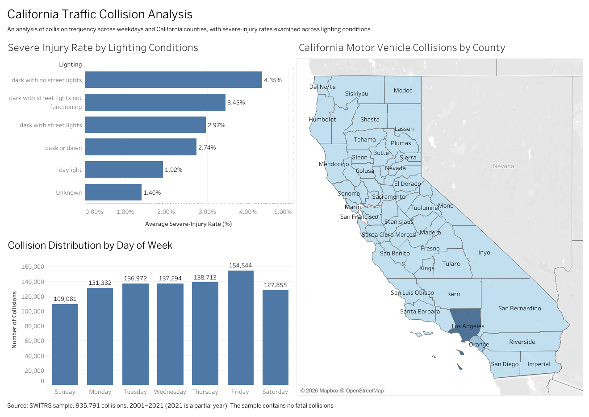

# California Traffic Collision Analysis (SWITRS) – PySpark ETL + Tableau

An end-to-end analysis of **935,791 California traffic collisions (2001–2021)** from the Statewide Integrated Traffic Records System (SWITRS). PySpark handles loading, joining, cleaning and SQL querying; Pandas, Matplotlib and Seaborn handle exploratory analysis; Tableau Public presents the key findings.

**Interactive dashboard:** [View on Tableau Public](https://public.tableau.com/app/profile/ipsit1548/viz/CaliforniaTrafficCollisionAnalysis/Dashboard1)

## Key findings

| Finding | Result |
|---|---|
| Busiest county | Los Angeles: 284,100 collisions (30.4% of the total) |
| Peak hour | 5 PM: 73,255 collisions |
| Busiest and quietest weekday | Friday 154,544, Sunday 109,081 |
| Lighting and severity | 4.35% of collisions on unlit roads cause a severe injury, against 1.92% in daylight |
| Broken street lights | 3.45% severe-injury rate (small group: 1,768 collisions) |
| Weather | Fog is the most severe (3.59%) and rain the mildest (1.92%) |
| Vulnerable road users | Severe-injury share is 13.66% for pedestrian-involved, 16.36% for motorcycle-involved and 7.18% for bicycle-involved collisions, against 2.37% overall |
| Fatal collisions | None in this sample (0.00%) |

## What the project does

1. **Load and join** the collisions, parties and victims tables in PySpark.
2. **Clean** the data: drop sparse columns, fix data types, fill missing values, check duplicates and flag (not delete) outliers.
3. **Encode, reorder and save** the cleaned data (Parquet/CSV).
4. **Explore** severity, weather, lighting, victims, time trends and geography.
5. **Query** seven business questions with Spark SQL.
6. **Visualise** the findings in Tableau Public.

## Repository contents

| File | Description |
|---|---|
| `ETL_Traffic_Data_Analysis_Ipsit_Mohanty.ipynb` | Full PySpark + Pandas notebook with outputs |
| `ETL_Traffic_Data_Analysis_Ipsit_Mohanty.pdf` | Report: approach, findings, assumptions, recommendations |
| `images/` | Dashboard screenshots |
| `requirements.txt` | Python packages used |

## Data

The data files are **not included** in this repository because of their size. The analysis uses sample CSV extracts of the SWITRS collisions, parties and victims tables. Place them in a folder and set `base_path` in the first code cell of the notebook.

## Assumptions and limitations

- Results describe the **sample** provided, not the full statewide database.
- The sample contains **no fatal collisions**, so severity analysis focuses on severe injury.
- **2021 is a partial year**, so its drop is a coverage effect, not a real decline.
- About **71% of records have no coordinates**; the map shows only the 28.5% that do.
- The sample victims table matches only about 9% of the sampled collisions, so victim counts use the injured-victim field on each collision.
- AWS S3 was not used; cleaned data was saved locally.

## Tools

PySpark, Pandas, NumPy, Matplotlib, Seaborn, Tableau Public, Jupyter.

## Author

Ipsit Mohanty